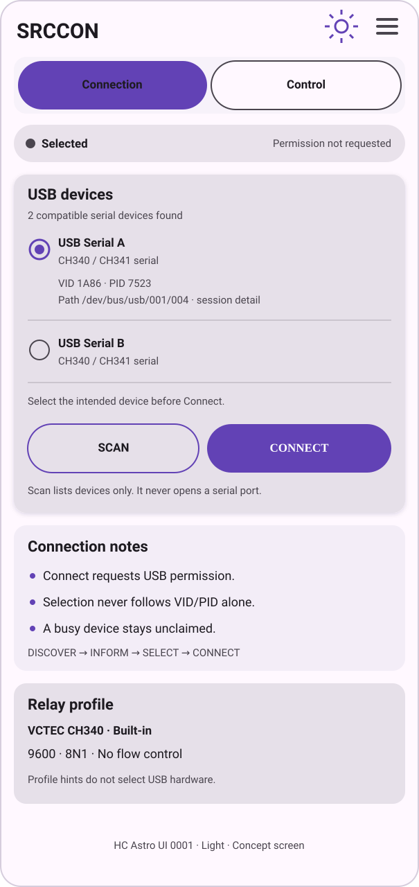
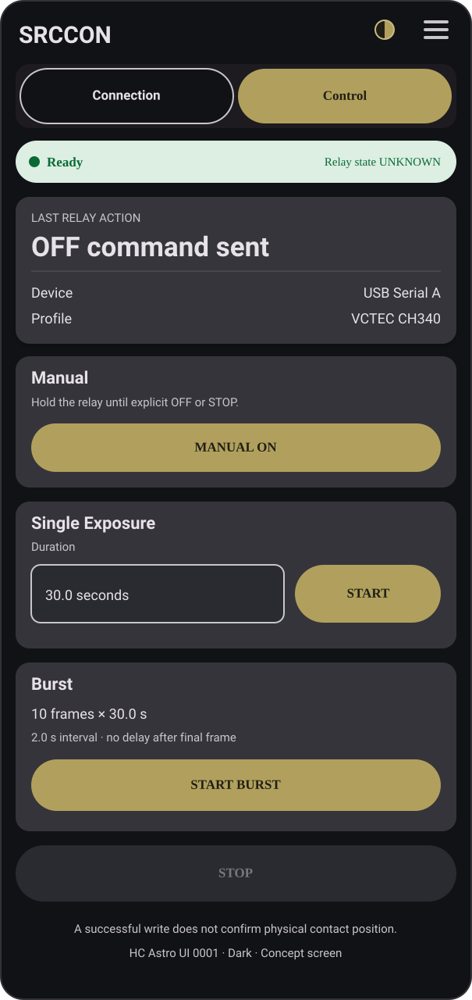
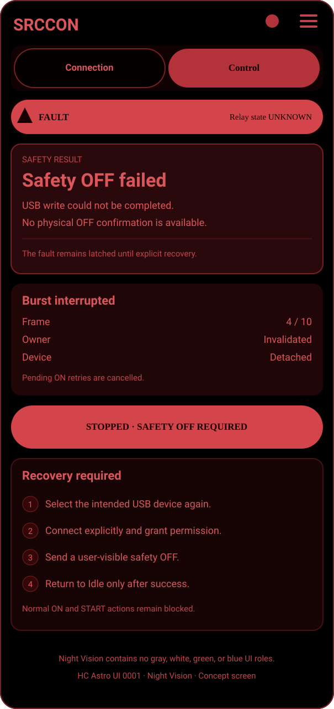

# HC Astro UI - 0001

> HC Astro Android application look and feel guide<br>
> 천체 관측용 Android 앱 공통 룩앤필 가이드<br>
> Revision: `0001` · Date: 2026-10-01 · Author: **SongPaHaeChi**

This package turns the visual language audited from **EAFCON 1.1.4** into a
reusable UI baseline for HC Astro applications, beginning with SRCCON. The
examples are newly drawn, code-based SVG mockups. No EAFCON screenshot or
product photograph is included.

이 패키지는 **EAFCON 1.1.4**에서 검토한 시각 언어를 SRCCON을 포함한 HC
Astro Android 앱에서 재사용할 수 있도록 정리한 기준서다. 예시는 새로 만든
SVG 목업이며 EAFCON 스크린샷이나 제품 사진을 복사하지 않았다.

## Example screens / 예시 화면

| Light · Connection | Dark · Control | Night Vision · Fault/STOP |
| --- | --- | --- |
|  |  |  |

The SVG canvases are `605 × 1280`, matching the portrait reference ratio used
during the EAFCON UI audit. They are design examples, not captured application
screens. Text, state, and available actions must always come from the actual
application state model.

## 1. Design character / 디자인 성격

HC Astro UI is a restrained Material 3 interface for use in the dark, with
equipment connected and gloves or low attention available. Its hierarchy is:

1. app identity and global actions;
2. persistent primary navigation;
3. a persistent, text-first equipment status pill;
4. one vertically scrolling task page;
5. large, explicit actions grouped into full-width cards.

Use the following principles.

- **State first:** connection, ownership, operation phase, and unknown physical
  state must be visible before controls.
- **Explicit actions:** scanning, selection, Connect, ON, START, STOP, and
  recovery are separate user actions.
- **Stable placement:** keep the primary switcher and status pill outside the
  page scroll area. Keep STOP in a predictable full-width position while an
  operation is active.
- **Low ornament:** use color, spacing, weight, and containers rather than
  decoration. Do not add gradients, glass effects, or animated backgrounds.
- **Night integrity:** Night Vision uses only black and dark red surfaces with
  muted red content. It must not fall back to gray Material containers.
- **Truthful hardware language:** a successful serial write describes a command
  sent; it does not prove a relay contact position.

## 2. Color system / 색상 체계

The following roles reproduce the values explicitly set by EAFCON 1.1.4. Use
opaque sRGB colors and keep semantic role names in code. Do not scatter literal
hex values across Composables.

### 2.1 Light

| Role | Hex | Intended use |
| --- | --- | --- |
| `primary` | `#6242B5` | selected navigation, primary buttons |
| `onPrimary` | `#FFFFFF` | content on primary |
| `primaryContainer` | `#E9DDFF` | emphasized non-critical container |
| `onPrimaryContainer` | `#211047` | content on primary container |
| `secondary` | `#645A70` | secondary accent |
| `background` | `#FFF8FF` | app background |
| `onBackground` | `#1D1A20` | content on background |
| `surface` | `#FFF8FF` | base surface |
| `onSurface` | `#1D1A20` | primary text and icons |
| `surfaceVariant` | `#E9E2EB` | status and contextual surfaces |
| `onSurfaceVariant` | `#4A454E` | secondary text and outlines |

### 2.2 Dark

| Role | Hex | Intended use |
| --- | --- | --- |
| `primary` | `#B1A05D` | selected navigation, primary buttons |
| `onPrimary` | `#211F14` | content on primary |
| `primaryContainer` | `#4D452A` | emphasized non-critical container |
| `onPrimaryContainer` | `#E5D48E` | content on primary container |
| `secondary` | `#C7BA83` | secondary accent |
| `background` | `#111216` | app background |
| `onBackground` | `#E6E2E8` | content on background |
| `surface` | `#18191E` | base surface |
| `onSurface` | `#E6E2E8` | primary text and icons |
| `surfaceVariant` | `#2A2B31` | status and contextual surfaces |
| `onSurfaceVariant` | `#C9C5CD` | secondary text and outlines |

### 2.3 Night Vision

Night Vision pins every surface-container role. This is a release requirement:
leaving any role on the Material default can introduce a bright gray patch.

| Role | Hex |
| --- | --- |
| `primary` | `#B4333A` |
| `onPrimary` | `#130000` |
| `primaryContainer` | `#330608` |
| `onPrimaryContainer` | `#D9565B` |
| `secondary` | `#A33A40` |
| `onSecondary` | `#120000` |
| `background` | `#000000` |
| `onBackground` | `#D9565B` |
| `surface` | `#050000` |
| `onSurface` | `#D9565B` |
| `surfaceVariant` | `#1B0405` |
| `onSurfaceVariant` | `#BD454B` |
| `surfaceDim` | `#030000` |
| `surfaceBright` | `#300A0C` |
| `surfaceContainerLowest` | `#000000` |
| `surfaceContainerLow` | `#100203` |
| `surfaceContainer` | `#170405` |
| `surfaceContainerHigh` | `#200607` |
| `surfaceContainerHighest` | `#29090B` |
| `outline` | `#7A2025` |
| `outlineVariant` | `#481014` |
| `error` | `#D3454B` |
| `onError` | `#160000` |

### 2.4 Component semantic colors

These component colors preserve the EAFCON status treatment while giving
SRCCON deterministic safety colors.

| Meaning | Light | Dark | Night Vision |
| --- | --- | --- | --- |
| Ready/connected container | `#DCEFE2` | `#DCEFE2` | `primaryContainer` |
| Ready/connected content | `#0A6A34` | `#0A6A34` | `onPrimaryContainer` |
| Danger/STOP container | `#BA1A1A` | `#FFB4AB` | `#D3454B` |
| Danger/STOP content | `#FFFFFF` | `#690005` | `#160000` |

Green is never used in Night Vision. Every status also has a text label and
shape/icon cue, so color is supplementary rather than the only signal.

Light and Dark roles not overridden above remain Material 3 roles in the app's
pinned Compose version. For reproducible screenshots, the examples use the
standard Material 3 surface containers: Light `surfaceContainerLow #F7F2FA`,
`surfaceContainer #F3EDF7`, `surfaceContainerHighest #E6E0E9`; Dark
`surfaceContainerLow #1D1B20`, `surfaceContainer #211F26`, and
`surfaceContainerHighest #36343B`.

## 3. Typography / 타이포그래피

Use the Android system sans-serif through Material 3. HC Astro UI 0001 has no
custom font dependency. This preserves Korean coverage, system rendering, and
user font-scale behavior.

| Purpose | Material style | Baseline specification | Additional treatment |
| --- | --- | --- | --- |
| App name | `titleLarge` | 22sp / 28sp | Bold |
| Screen/card title | `titleMedium` | 16sp / 24sp | Bold |
| Principal reading | `displaySmall` | 36sp / 44sp | Bold, tabular numerals where available |
| Body/control label | `bodyLarge` | 16sp / 24sp | Regular |
| Supporting copy | `bodySmall` | 12sp / 16sp | Regular |
| Button/status label | `labelLarge` | 14sp / 20sp | Medium |
| Dense metadata | `labelSmall` | 11sp / 16sp | Medium |

- Use sentence case for prose and Title Case only where established by Android
  conventions. Short safety actions such as `STOP` may remain uppercase.
- Use `—` for unavailable readings. Use `UNKNOWN` only for a modeled physical
  or protocol state whose uncertainty matters to safety.
- Allow 200% font scale. Do not depend on a one-line fixed-width button when a
  translated label can wrap; use adaptive width or a second row.
- Keep user names, USB strings, profile names, and unknown technical errors
  verbatim. Localize UI labels at the UI boundary.

## 4. Spacing, shape, and sizing / 간격과 형태

Use a compact 2dp-based rhythm derived from EAFCON.

| Element | Value |
| --- | --- |
| Page horizontal inset | `16dp` |
| Page vertical group gap | `8dp` to `10dp` |
| Card inner padding | `14dp` to `16dp` |
| Dense card padding | `12dp` |
| Control row gap | `8dp` to `10dp` |
| Segmented item gap | `6dp` |
| Primary switcher inner padding | `6dp` |
| Primary switcher corner radius | `18dp` |
| Status pill corner radius | 50% / fully rounded |
| Status pill padding | `14dp` horizontal, `7dp` vertical |
| Context tile corner radius | `12dp` |
| Dialog width | `92%`, maximum `560dp` |
| Dialog corner radius | `22dp` |
| Dialog padding | `18dp` |
| Action/input minimum height | `56dp` |
| Minimum touch target | `48 × 48dp` |

Prefer a single full-width column. On a foldable or tablet, cap the task column
at a readable width or use an intentional two-pane layout. Do not simply stretch
numeric fields and buttons across the full unfolded display.

## 5. Components / 컴포넌트

### Top app bar

- Left: bold application name, for example `SRCCON`.
- Right: theme control followed by overflow/menu.
- Use real vector icons in production and provide localized content
  descriptions. The example SVG uses simple glyphs only to remain standalone.
- Theme order is Light → Dark → Night Vision. Persist the user's selection.

### Primary switcher

- Connection and Control remain visible below the top app bar.
- Container: `surfaceContainerLow`, `18dp` radius, `6dp` inset and gap.
- Selected destination: filled primary button. Other destination: outlined
  button.
- Profiles, Settings, About, and diagnostics are secondary menu destinations.
  Android Back returns from a secondary page to the previously active primary
  page.

### Equipment status pill

- Place it under primary navigation and outside page scrolling.
- Left side: small status marker plus plain-language state.
- Right side: compact high-value context, truncated safely on narrow screens.
- Never display connection and relay state as one ambiguous word. Examples:
  `Ready · Relay state UNKNOWN`, `Active · Single 18.4 s`, or
  `Fault · Safety OFF failed`.
- In Night Vision, use `primaryContainer/onPrimaryContainer` for every ordinary
  connection state. Reserve `error/onError` for an actionable fault.

### Cards

- Use one card per user decision or task: device selection, manual control,
  single exposure, burst, active operation, recovery.
- Use a bold `titleMedium`, then state/context, then actions.
- Keep related fields and their action in the same card. Place explanatory text
  after the control in `bodySmall`.
- Use dividers only when two data groups would otherwise read as one.

### Buttons

- Filled primary button: the expected next action (`CONNECT`, `START`, `SEND
  SAFETY OFF`).
- Outlined button: secondary or reversible action (`SCAN`, `DISCONNECT`,
  `CANCEL`).
- Text button: low emphasis dialog or menu action.
- Error button: STOP and fault recovery actions with immediate safety meaning.
- A disabled control must remain readable and must be accompanied by visible
  state explaining why it is unavailable.

### STOP

- Show a full-width STOP button in a stable location whenever Manual, Single,
  or Burst owns an active operation.
- STOP uses the theme's danger/error pair, not the ordinary primary color.
- On activation, invalidate ownership first, cancel pending work, and schedule
  the safety OFF attempt. The UI immediately changes to `Stopping…`; it changes
  to a sent or fault result only when that result is known.
- Do not hide STOP during exposure or inter-frame wait.

## 6. Screen patterns / 화면 패턴

### Connection

Order the flow as `DISCOVER → INFORM → USER SELECTS → USER CONNECTS`.

1. passive device list card with radio selection;
2. selected device details and driver family;
3. equal-width SCAN and CONNECT/DISCONNECT actions;
4. connection notes explaining that Scan does not request permission or open a
   serial port;
5. inline message/error region.

Discovery must not visually imply selection. Previously used hardware may be
sorted or marked, but CONNECT remains disabled until the user selects a device.

### Control

Place operation status before mode controls. A recommended SRCCON order is:

1. relay/operation state card;
2. Manual control card;
3. Single Exposure card;
4. Burst card;
5. persistent active-operation STOP region;
6. precise status and error messages.

Manual, Single, and Burst share one coordinator and one visible owner. Disable
conflicting START/ON controls while one mode owns the relay.

### Fault and recovery

When OFF cannot be transmitted, keep `Fault` and `Relay state UNKNOWN` visible.
The recovery card states the exact sequence:

1. select the intended device again;
2. explicitly Connect;
3. send a visible safety OFF;
4. return to normal Idle only after that command succeeds.

Do not replace the fault screen with an ordinary disconnected or OFF state.

## 7. Accessibility / 접근성

- Meet WCAG AA contrast for ordinary text and controls. Check disabled content
  separately because opacity can reduce contrast.
- Never encode Ready, Active, Fault, ON, or OFF only with color. Always include
  a text label; add an icon or shape when useful.
- Give vector icons meaningful content descriptions. Decorative dots are hidden
  from accessibility services.
- Keep TalkBack focus order aligned with the visual sequence: navigation,
  status, fields, primary action, supporting information.
- Announce state changes such as permission denial, operation start, STOP, and
  fault with a restrained live region. Do not repeatedly announce timer ticks.
- Preserve minimum `48dp` touch targets and visible focus indication.
- Support system font scaling, Korean/English expansion, portrait, split screen,
  and foldable widths. Test at least 320dp width and 200% font scale.
- Do not require animation to understand progress. Respect reduced motion and
  avoid blinking in Night Vision.

## 8. Hardware and safety wording / 하드웨어·안전 문구

SRCCON controls a write-only relay protocol. Use wording that reports software
evidence precisely.

| Use | Avoid |
| --- | --- |
| `ON command sent` | `Relay ON confirmed` |
| `OFF command sent` | `Relay OFF confirmed` |
| `Relay state UNKNOWN` | `Relay is OFF` after a failed write |
| `Safety OFF failed` | `Disconnected safely` without evidence |
| `USB device detached` | silently returning to Idle |
| `Stopping…` | hiding the active operation immediately |

Before ON, surface validation errors close to the field or selection that
caused them. Invalid or missing OFF configuration blocks ON and must be stated
plainly. During an active operation, settings shown in the UI are an operation
snapshot; editing stored settings does not alter the running operation.

Software cannot promise OFF after force-stop, process kill, OS crash, phone
power loss, USB power loss, or relay hardware failure. Put this limitation in
Help/About and the operator guide. Show it in the task flow only when the user
must make a decision.

## 9. Implementation notes

- Implement with Jetpack Compose Material 3 and semantic color roles.
- Keep `AppThemeMode`, palettes, typography, and shapes in one theme package.
- Keep USB and operation state in service/controller-owned state. Composables
  render state and dispatch intents; they do not own relay timing.
- Render state from a sealed/domain model rather than reconstructing it from
  button enabled values.
- Use Android string resources for all UI copy. Keep device strings and imported
  user data unchanged.
- Add screenshot tests or deterministic previews for Light Connection, Dark
  Control, Night Vision Fault, large font, and narrow width. A preview proves
  layout only; it does not prove hardware behavior.

## 10. Package contents

```text
HC Astro UI - 0001/
├── README.md
└── images/
    ├── 01-light-connection.svg
    ├── 02-dark-control.svg
    └── 03-night-fault-stop.svg
```

Future revisions should increment the four-digit identifier and record token or
component changes. Applications may evolve independently, but shared token
changes should be reconciled into a later HC Astro UI package rather than
silently changing this archive.
